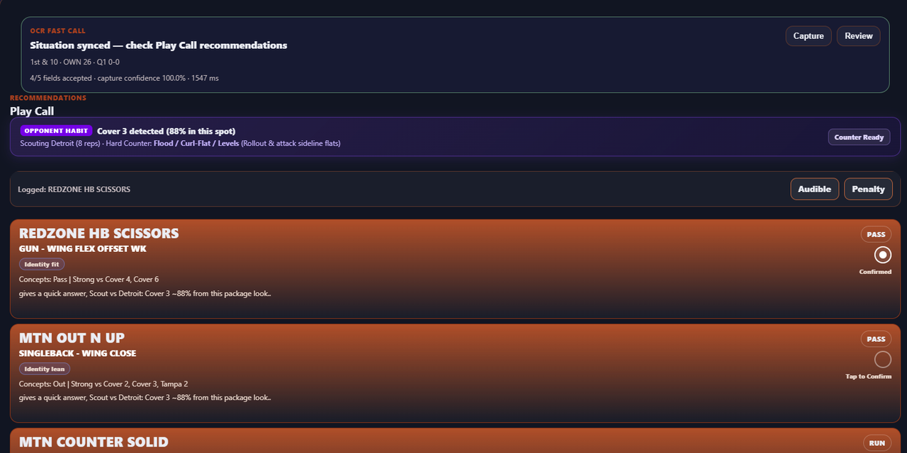
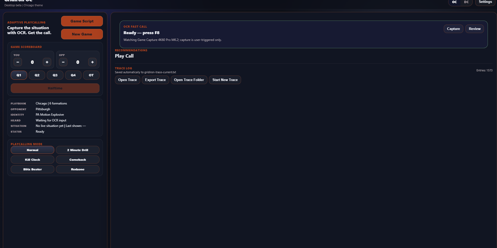
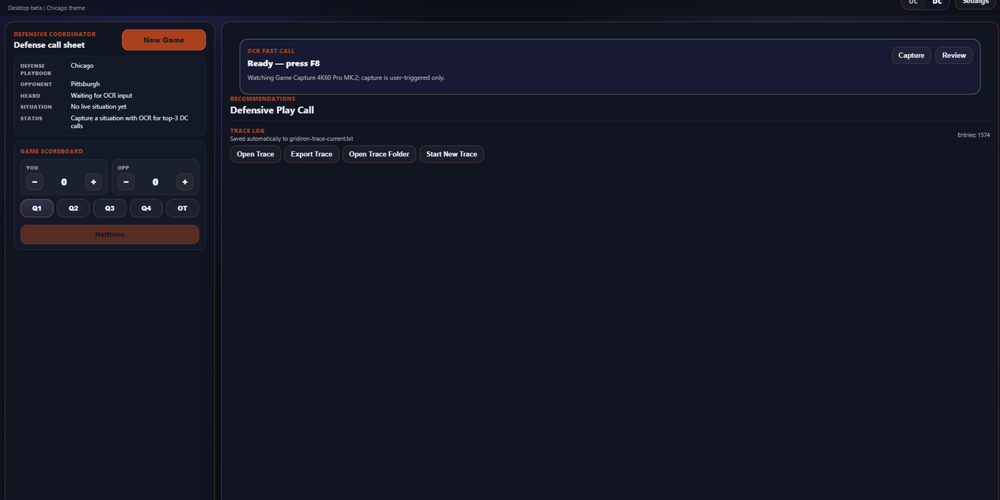
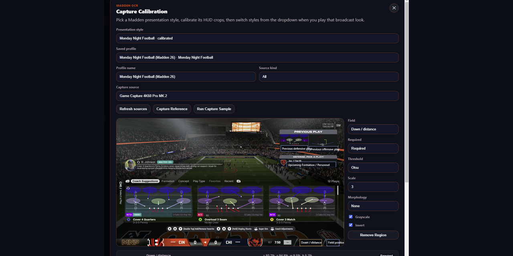
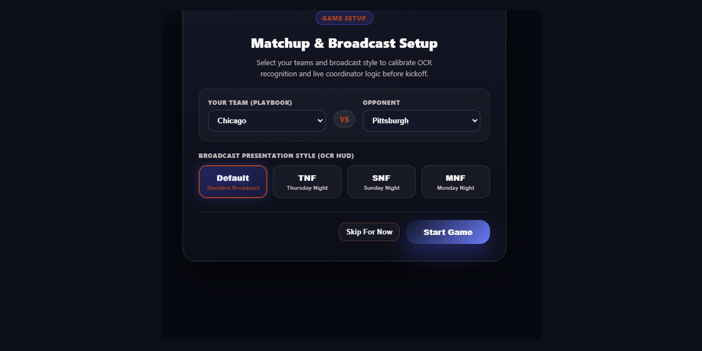
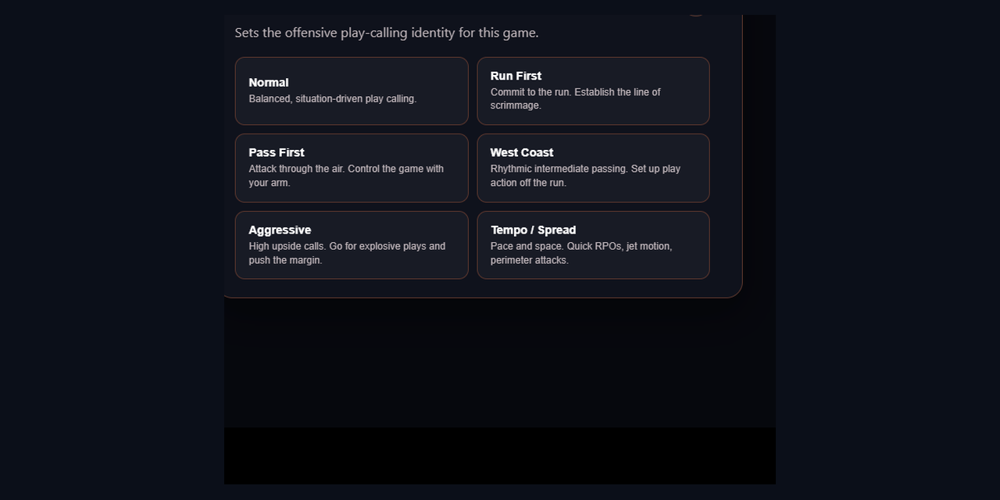
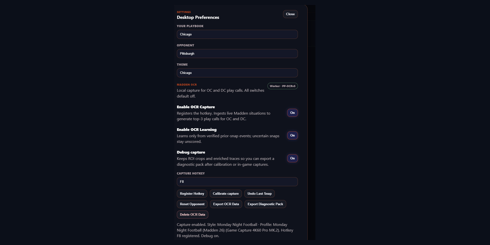

# Gridiron OC (PC)

[](#prerequisites)
[](#testing--quality-verification)
[](https://github.com/GenNowGamer/Gridiron-OC-PC/releases/latest)
[](#license--trademarks)

**Gridiron OC** is a coach tablet for Madden NFL 26 and Madden NFL 27. **New Game** deals an opening script and 15 situational cards. You confirm the play you ran, and that card is replaced. F8 logs the snap after it ends. It does not pick a play. A success rate appears after three results for that play, situation, and opponent, and it never chooses the next card.

Capture, OCR, and the optional play-call detector run on this PC. Nothing from the screen is sent to a cloud service.

<p align="center">
  
</p>

---

## Table of Contents

- [Core Purpose & Value Proposition](#core-purpose--value-proposition)
- [Key Features](#key-features)
  - [Offensive Coordinator (OC) Workspace](#1-offensive-coordinator-oc-workspace)
  - [Defensive Coordinator (DC) Workspace](#2-defensive-coordinator-dc-workspace)
  - [How a snap is graded](#3-how-a-snap-is-graded)
  - [Computer Vision OCR Capture](#4-computer-vision-ocr-capture)
- [Operator's Field Manual (User Guide)](USER_GUIDE.html)
- [How to Use Gridiron OC](#how-to-use-gridiron-oc)
  - [OCR Screen Capture Workflow](#ocr-screen-capture-workflow)
- [System Architecture](#system-architecture)
- [Installation & Setup](#installation--setup)
- [Testing & Quality Verification](#testing--quality-verification)
- [Security & Privacy Standards](#security--privacy-standards)
- [License & Trademarks](#license--trademarks)

---

## Core Purpose & Value Proposition

The live window is an offensive call sheet. It does not recommend a play and it does not call a defense.

1. **New Game deals the sheet.** One 15-play opening script and 15 situational cards come from the selected team's offensive playbook.
2. **Ran it confirms what you called.** On the script, that advances to the next scripted play. On a situational card, only that card is replaced.
3. **F8 or auto-capture logs the snap that just ended.** Yards come from the change in yard line. Down and distance decide whether that gain was a success. A previous offensive name that matches your playbook is scored even when you did not press **Ran it**. The capture does not change the script or the cards.
4. **Each situational card rotates its own list.** A play comes back to that card only after every other play that fits the card has already been shown. Team identity does not weight that draw.
5. **Capture stays on this PC.** OCR and the optional play-call detector run locally. Auto-capture stays off until `playcall.onnx` exists.

---

## Key Features

### 1. Offensive Coordinator (OC) Workspace

<p align="center">
  
</p>

- **Madden 26 and Madden 27 catalogs:** Each catalog is the 32 NFL team playbooks only. Madden 26 offense is 13,793 plays (`data/madden26/plays.json`). Madden 27 offense is 19,105 plays (`data/madden27/plays.json`). Play types are `RUN`, `PASS`, `PA`, and `RPO`. Alternate scheme books are not included.
- **Opening script:** New Game deals 15 plays. Goal Line formation plays are left out of the script. **Ran it** moves to the next play. F8 and auto-capture do not move the script or put a play back.
- **15 situational cards:** 1st & med, 2nd & med, 2nd & long, 3rd & med, 3rd & long, 4th & short, Backed up, Red zone, Goal line, Blitz beater, Man beater, Cover 3 beater, Shot, Quick game, and PA / motion. **Ran it** replaces only that card. The replacement is drawn from plays that fit the card and have not been shown there yet this game. Plays already sitting on the other cards are skipped while an unseen play remains. A play can return only after that card's fitting list has been shown once. Goal Line formation plays, such as Goal Line / Normal / PA Sprint, appear only on the Goal Line card.
- **Situation glow:** A captured down, yard line, or defensive shell lights the matching card with a gold pulse and a Now mark. A down lights its down card. Own 10 or closer lights Backed up. Opponent 20 or closer, outside the goal line, lights Red zone. A real goal-line spot lights Goal Line. Blitz, Man, Cover 1, and Cover 3 light those beater cards. Several cards can glow at once. The plays on the cards do not change.
- **Offense / Defense:** The toolbar switch starts on **Offense**. **Defense** stops auto-capture and F8 until you switch back. It does not deal defensive cards or score a defensive call. **New Game** returns to **Offense**.
- **Game State:** On offense, the button records how the drive ended: Touchdown, Field Goal, Sack, QB Scramble, Punt, Safety, Interception, Pick 6, Fumble, Scoop & Score, Turnover on Downs, or Quarter Expired. Touchdown, field goal, punt, safety, interception, fumble, and turnover on downs switch the sheet to **Defense**. Sack, QB Scramble, Pick 6, Scoop & Score, and Quarter Expired leave it on **Offense**. A pending **Ran it** play is graded with that result.
- **Series strip:** Their offense, their defense, your record, and last capture describe the current game only. They clear when the app starts and when **New Game** is confirmed. They are not saved for the next launch.
- **Last capture:** The strip shows the logged play, the yards, and success or failure. A new set of downs that is still 1st & 10 uses the yard-line change, so a 10-yard gain that stays 1st & 10 is `+10 · success`. Reading the same play-call screen again does not replace that result with a no-gain failure. A rate for that play, slot, and opponent appears after three results and does not choose the next card.
- **Play-call detector:** Settings can train a local YOLOv8n model from F8 play-call samples and **Save other screen** negatives. Training needs at least one of each. The model is `playcall.onnx` under the app's user data, not a file in the repo. Auto-capture stays disabled until that file exists, and it also stays off while Training mode is on. The watch loop looks about four times a second, waits 250 ms, and runs one OCR burst per play-call appearance. A screen counts as a play call when down-and-distance and field position are both at least 0.75. F8 still captures immediately. A training failure is one short sentence in Settings. The Ultralytics log is not shown there.


### 2. Defensive Coordinator (DC) Workspace

<p align="center">
  
</p>

The live window does not recommend or confirm a defensive play. Defensive playbooks stay loaded so a captured previous defensive name can be read as a shell. Blitz, Man, Cover 1, and Cover 3 light the matching beater card. Madden 26 defense is 8,214 plays (`data/madden26/defensive_plays.json`). Madden 27 defense is 11,077 plays (`data/madden27/defensive_plays.json`). Play types are `MAN`, `ZONE`, `BLITZ`, and `MATCH`. Alternate defense books are not included.

### 3. How a snap is graded

`shared/resultLabels.js` compares the previous accepted spot with the next play-call read. **Ran it** saves that spot for the card you confirmed. A capture with no **Ran it** still grades the snap when the previous offensive name matches a play in your book. The first read of a drive has no earlier spot, so it is not graded until the next play-call screen.

- Yards are the change in absolute field position. Own yard line counts up from 0. Opponent yard line counts as `100` minus the number. Midfield is 50. A jump larger than 80 yards is ignored as a misread.
- Down and distance supply the yards only when one of the yard lines is missing. If the down advances by one, yards are the old distance minus the new distance. If the down returns to 1st from any later down, yards are at least the previous distance.
- The same down, the same distance, and a yard line that did not move is the same screen. That read is not logged and does not replace the previous result.
- A gain that reaches a new set of downs is a success, including 1st & 10 that stays 1st & 10 when the yard line moved at least the yards to go. Otherwise 1st down succeeds at half the yards to go, and 2nd down succeeds at 70% of the yards to go.

### 4. Computer Vision OCR Capture

<p align="center">
  
</p>
 
 - **Local Computer Vision (Madden OCR DC & OC):**
   - Connects to your gameplay via the bundled **Gridiron Capture Bridge** (compatible with PC window capture or Elgato capture cards).
   - Reads down, distance, field position, the previous offensive play, and the previous defensive play. The upcoming formation graphic is not on the offensive play-call screen, so that box is not required to log a snap.
   - **Down / distance slot reader:** Before general OCR, the capture worker splits that crop into the ordinal, the ampersand, and the yards and matches them to a legal spot (`1st`–`4th`, `&`, `1`–`40`). A clear match is used as the read. A close call, including `1ST & 10` when it resembles `19`, leaves the crop to PP-OCRv5. Draw the box through the last yard digit and stop before the next HUD glyph; a separate `1` to the right is not part of the distance. A thin marker on the far left of the box is ignored.
   - Calibrates to major broadcast presentation styles (Default, TNF, MNF, SNF).
   - Adaptive capture plans three frames, 120 ms apart, after a 100 ms settle, and may extend to five. OCR for each frame runs during that spacing instead of after the burst. It stops after two frames when every region already agrees and each required field is stable: usable structure and confidence of at least 0.85. Field position does not stop early on a two-digit yard that a later short digit could reject as leading-digit bleed, or when OWN/OPP is still undecided. A disagreement on any region, including a previous-play name, keeps the third frame. Capture extends to five when a required field is missing, below a 2-of-3 agreement, or structurally invalid. Diagnostics record `adaptiveSampling.earlyStopped`, per-frame OCR text, crop hashes, stale/duplicate-frame counts, and separate capture, sampling, recognition, and total timings.
   - **Debug capture** retains field crop images locally for diagnostics. Diagnostic packs include only the active session segment; sessions rotate after 40 events, so include adjacent `ocr-debug-*` folders when sharing a full play session. The OCR JSON export records field decisions. It does not include raw frames.
   - **Deterministic Normalization & Repair Engine:** Automatically repairs clipped personnel fragments (`RITER`, `RTER`, `RBITEIR`, `RBITEISR`, `RITEISR`, `RIYELWR`, `IRBIOTELWR`), corrupted HUD chrome (`CYAALB`, `CYAAALB`), and glued situation lookalikes. Outlined down-and-distance text is repaired only when the full number cannot be a real distance: `'2'ND'9''7'` / `2ND97` → `2nd & 7`, `200&11` → `2nd & 11`, `130&3` → `3rd & 3` (the leading `1` is a HUD marker), `30&7` → `3rd & 7`, `2WD&81` → `2nd & 8`, `2ND&101` → `2nd & 10`, and `INCHES1` → `2nd & 1` when the ordinal is `2ND`. Sunday Night outlined short yardage accepts `'3'RD'&MCHES` and `'3'RD':'INCHES` as `3rd & 1`: `MCHES` / `MGHES` / `INGHES` / `INCRES` are the same "Inches" token, and a colon after the ordinal is the outlined ampersand. Outlined `m` before the ampersand is the same ordinal repair as `3D&`: `'3'm&'3'` → `3rd & 3`, and that `M&` token is enough distance evidence to accept the spot. Real `2nd & 9`, `2nd & 11`, `2nd & 21`, and `3rd & 11` stay unchanged. The same pass still repairs `1STS10` / `'1'STS'1''0'` → `1st & 10`, `'2'NDG'3'` / `2NO&6` → `2nd & 3` / `2nd & 6`, `38] &5` / `3BD & GOAL` → `3rd & 5` / `3rd & Goal`, and `BRO & 14` / `SRO & 18` → `3rd & 14` / `3rd & 18`, plus glued play names (`BOOMERANGSLOTSWING`, `REDZONEHBSCISSRS`, `SDEZONESPLIT`, `SILVERSHOOTNCH`, `SAMMKELOOP`, `DTMKELOOPA`, `LBBLITZO`, `COVERIMBBLITZ`, `LDUBLEWRI`, `ZZZIN`, `MTNYCORNERUNER`, `NCKELSIMZ`, `NCKELZTRAP`, `ESCAPE`, `FKTOSSSLIDE`, `DEEPSTICK`, `MTNDRIVE`, `FOURVERTICALS`). A dropped `I` in PIVOT repairs before catalog match: `BENCHDIGPVOT` → `BENCH DIG PIVOT`.
   - **Whitespace-Agnostic Compact Catalog Matching:** Employs normalized, whitespace-free compact Levenshtein distance evaluation in the catalog matcher (`rawAgreesWithMatch`), automatically healing glued play names with OCR dropped characters without requiring manual dictionary additions.
   - **Structural Broadcast Personnel Recognition:** Utilizes generalized structural sequence and archetype matching across all presentation styles (Default, TNF, MNF, SNF). Fused broadcast pipes and ornament artifacts (such as TNF badge compressions `RYTITEIWR`, `ITEIR`, `RITEIR`, `ITER`, `1TE3WR`, `RBITEIR`, `IRBITEIWR`) are automatically resolved to legal NFL personnel packages (`1RB - 1TE 3WR`) without requiring manual review.
   - **Formation and personnel:** That field is optional on the offensive play-call screen, because Madden does not show the upcoming personnel graphic there. Skill counts must add to 5 (`RB + TE + WR`). Empty backfield is valid (`0RB - 1TE 4WR`, `0RB - 2TE 3WR`). `0RB` paired with TE + WR totaling 4 is treated as a misread `1RB`. Heavy is the exception: `1RB - 2TE 1WR` accepts when the formation or set name contains Heavy. There is no review step during a game. A field under 70% is left out.

---

## How to Use Gridiron OC

### OCR Screen Capture Workflow

<p align="center">
  
</p>

1. In **Settings**, choose your playbook, the opponent, and **Madden 26** or **Madden 27**.
2. Select the capture card or the Madden window, calibrate the down-and-distance and field-position boxes, and test the profile.
3. Press **New Game**. That deals a new opening script and 15 situational cards.
4. Enable **OCR Capture**. The capture hotkey is **F8**.
5. Call the script play or a situational card in Madden, then press **Ran it** on that tile. The script advances, or that one card is replaced. F8 does not do either. A play you pick inside Madden can still be scored on the next capture when its name matches your playbook.
6. On the next play-call screen, press **F8**, or leave auto-capture on. A field is logged only when its read clears 70%. Yards are the change in yard line. The strip shows success or failure. The cards stay as they were.
7. Press **Defense** when the other team has the ball. Auto-capture and F8 stay off until you press **Offense**. **Game State** does that for a drive-ending result.
8. To use auto-capture, turn **Training mode** on, save play-call samples with F8 and at least one **Save other screen**, then press **Train detector**. After `playcall.onnx` is written, turn Training mode off and turn **Auto-capture play-call screen** on. Restart the app if it was open while training finished.

<details>
<summary><b>📸 Click to explore additional Coordinator & Preferences UI Screens</b></summary>
<br>

| Coordinator Style Picker | Desktop Preferences & Calibration |
| :---: | :---: |
|  |  |
| *Tailor team offensive scheme (West Coast, Run First, Tempo/Spread, Aggressive)* | *Fine-tune local OCR engine, hotkeys, and diagnostic exports* |

</details>

---

## System Architecture

Gridiron OC is built on an isolated, modular architecture designed for high stability and real-time execution:

```
[ Electron Main Process (main.js) ]
       │
       ├── IPC Bridge (preload.js)
       │
[ Renderer Workspace (app.js, index.html) ]
       ├── Adaptive Recommendation Core (shared/recommendationCore.js)
       ├── Defense Scorer (shared/defenseRecommendationCore.js)
       ├── Stage-2 Slate Builder (shared/selectionEngine.js)
       ├── End Game Report Builder (shared/coordinatorReport.js)
       ├── Madden Penalty Catalog (shared/penaltyCatalog.js)
       ├── Opening Script (shared/openingScript.js)
       ├── Situational Cards (shared/situationBoard.js)
       ├── Sheet Session (shared/tabletSession.js)
       ├── Snap Grades (shared/resultLabels.js)
       └── Play-Call Detector (ocr-sidecar/ocr_sidecar/screen_detector.py)
       │
[ OCR & Vision Subsystem (ocr/) ]
       ├── Gridiron Capture Bridge (capture-bridge/GridironCaptureBridge.exe)
       ├── Python OCR Sidecar Worker (ocr-sidecar/ - OpenCV / PP-OCRv5, Tesseract fallback)
       └── Shared Text & Grammar Parsers (ocr/shared/)
```

- **Playbooks:** `data/madden26/` and `data/madden27/` each contain `plays.json` (offense) and `defensive_plays.json` (defense). Settings chooses the version. Both catalogs use team code, formation, set, play name, and type. Madden 27 names keep the spaced spelling used in game (`SHOCK H OPTION`, `COVER 3 SKY WK`).
- **Detector files:** Training writes `playcall.onnx` and the sample set under Electron `userData` (`models\playcall.onnx`, `playcall-dataset`). Those files are not committed. Ultralytics is used only while training. The installed app runs the exported ONNX model.
- **Data Persistence:** User preferences and team profiles are saved locally in the standard Electron `userData` directory (`preferences.json`, `localStorage`). The call-sheet reads for their offense, their defense, your record, and last capture are kept only for the current game.
- **Telemetry & Privacy:** Zero cloud telemetry. All playbooks and screen captures are processed strictly on your local hardware.

---

## Installation & Setup

### Prerequisites

- **OS:** Windows 10 or Windows 11 (64-bit)
- **Node.js:** Node 18.0.0 or higher
- **Hardware:** Dual-core CPU or better, 4GB RAM minimum (8GB recommended for concurrent OCR capture)

### Development Setup

Clone the repository and install dependencies:

```powershell
npm install
npm start
```

*Note: `npm start` runs `npm run check:core` before launching Electron.*

### Building the Windows Installer

To generate a standalone Windows NSIS installer (`.exe`):

```powershell
$env:ALLOW_GPL_FFMPEG="true"
npm run dist
```

The installer is `dist\Gridiron Play Advisor Setup <version>.exe`, using the version in `package.json`. `npm run dist` runs `verify:pc`, builds the OCR worker and Capture Bridge, then packages with electron-builder. Do not rebuild when that setup file for the current version is already present and you are only publishing it.

---

## Testing & Quality Verification

Gridiron OC includes a comprehensive regression and domain validation suite. Always run verification before packaging:

```powershell
# Run all PC verification suites (core check, gameplan tests, regressions, OCR tests, defensive tests)
npm test
# or:
npm run verify:pc

# Run individual test components
npm run check:core             # Validate local PC shared modules
npm run test:gameplan          # Opening script, situational cards, snap grades, and tablet session
npm run test:regression        # App UI & play-calling regressions
npm run test:ocr:js            # OCR grammar, confusables, and parser checks
npm run test:ocr:worker        # Python sidecar unit tests
npm run test:ocr               # JS OCR checks plus the sidecar suite
node scripts/smoke-defense-situation.mjs  # DC situation and blitz balance checks
```

---

## Security & Privacy Standards

Gridiron OC enforces strict local-only execution and repository hygiene practices:

- **100% Local Execution & Zero Telemetry:**
  - OCR and the play-call detector run locally via on-device PP-OCRv5, with Tesseract as fallback, and an ONNX runtime.
  - The call sheet and playbooks stay on this PC. Capture does not call a network service.
  - No prompt data, game telemetry, audio, or video streams are ever transmitted to external cloud servers.
- **Repository Hygiene & Secret Isolation:**
  - Sensitive configurations (`.env`, `.env.*`), credentials (`credentials.json`), certificates (`*.jks`, `*.keystore`, `*.p12`), and private Electron `userData/` are strictly excluded via `.gitignore`.
  - Python virtual environments (`ocr-sidecar/.venv/`, `.venv/`) and native build intermediate outputs are permanently ignored.
  - Internal development records and hardware logs (`session_handoff.md`, `*.log`) remain exclusively local.
- **Distribution Hygiene:**
  - Packaged installers (`dist/`, `*.exe`) are excluded from Git repository tracking and are distributed exclusively through official GitHub Releases assets.
- **Author Identity Privacy:**
  - All repository commits are authored and mapped to verified GitHub no-reply addresses (`GenNowGamer@users.noreply.github.com`).

---

## License & Trademarks

- **Proprietary Software:** All rights reserved.
- **Third-Party Notices:** Bundled open-source libraries and licenses are detailed in [THIRD_PARTY_NOTICES.md](THIRD_PARTY_NOTICES.md).
- **Disclaimer:** Gridiron OC is an independent companion tool and is not affiliated with, endorsed by, sponsored by, or approved by Electronic Arts Inc., EA SPORTS, the National Football League (NFL), or any NFL team. All product and company names are trademarks™ or registered® trademarks of their respective holders.
