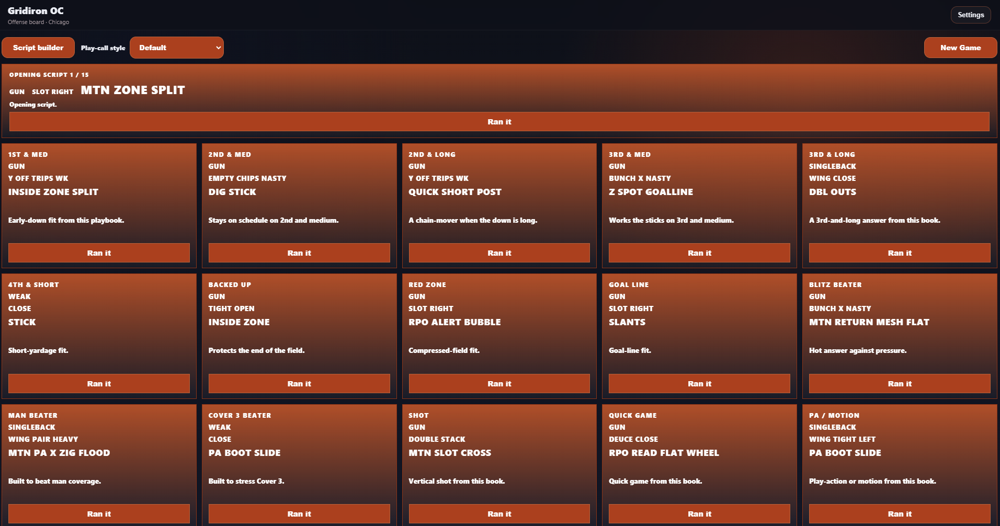
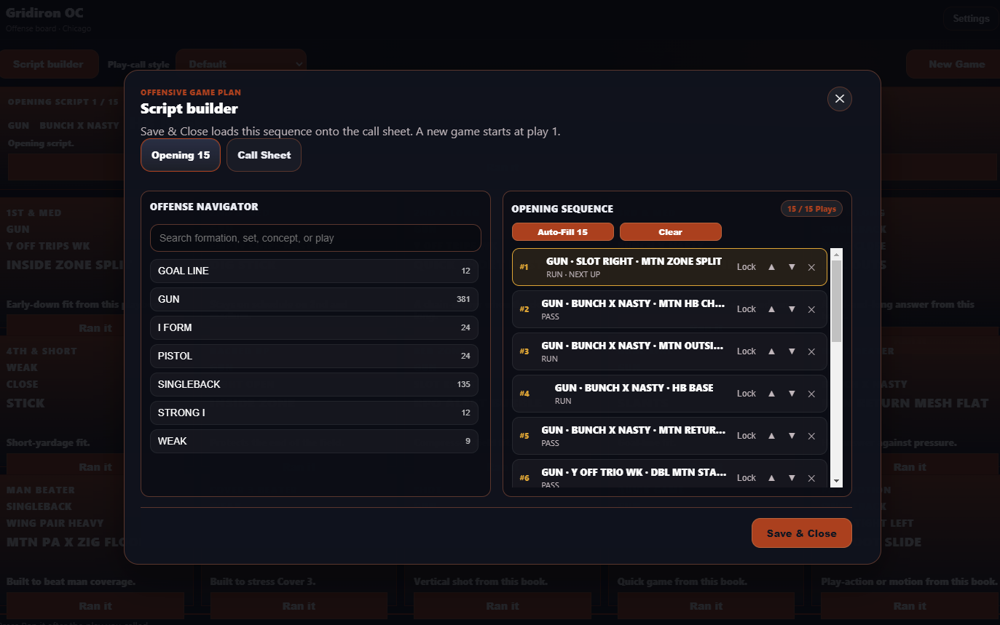
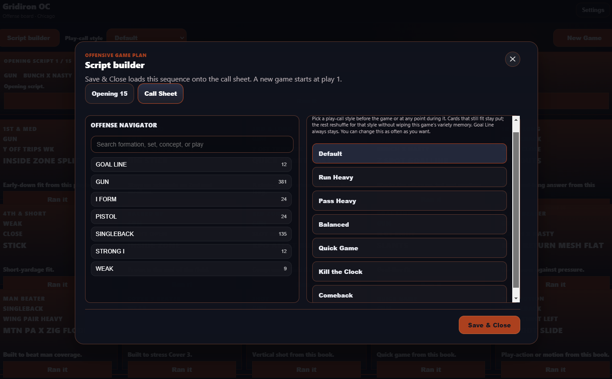
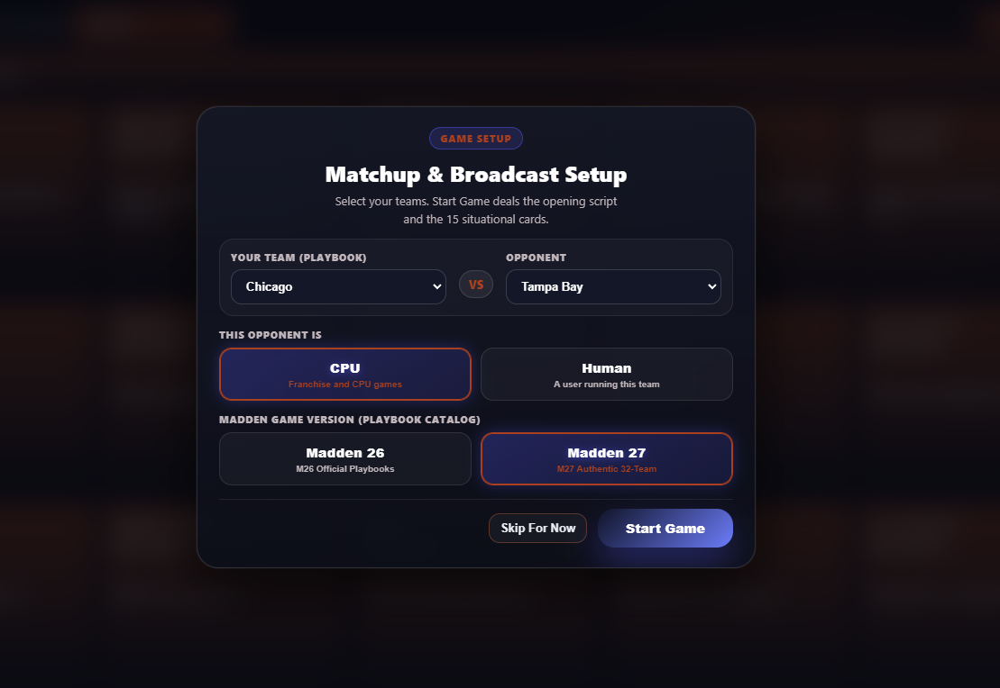
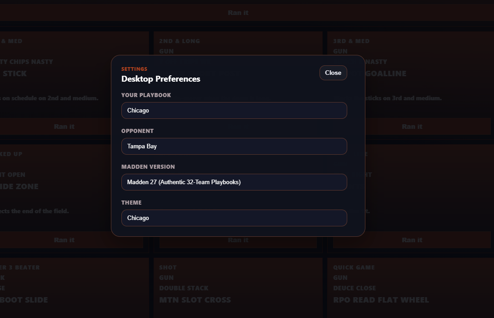

# Gridiron OC (PC)

[](#prerequisites)
[](#testing--quality-verification)
[](https://github.com/GenNowGamer/Gridiron-OC-PC/releases/latest)
[](#license--trademarks)

**Gridiron OC** is a tactical coach tablet for Madden NFL 26 and Madden NFL 27. **Start Game** opens the Script builder with one 15-play opening script. **Save & Close** loads that list onto the call sheet, starting at play 1. Fifteen situational cards sit under the script. **Ran it** advances the script or replaces one card, keeping you in full command of every play call.

Gridiron OC operates with 100% on-device local execution. All playbooks, opening scripts, and situational decks stay privately on your PC.

---

## Table of Contents

- [Core Purpose & Value Proposition](#core-purpose--value-proposition)
- [Key Features](#key-features)
  - [Call sheet](#1-call-sheet)
  - [Script builder](#2-script-builder)
  - [Playbooks](#3-playbooks)
- [How to Use Gridiron OC](#how-to-use-gridiron-oc)
- [System Architecture](#system-architecture)
- [Installation & Setup](#installation--setup)
- [Testing & Quality Verification](#testing--quality-verification)
- [Security & Privacy Standards](#security--privacy-standards)
- [License & Trademarks](#license--trademarks)

---

## Core Purpose & Value Proposition

The live window is an authentic offensive call sheet designed for situational play selection.

1. **Start Game opens the Script builder.** When starting a fresh session or game, the opening script sequence begins clean and empty (0 / 15 Plays). You can tap **Auto-Fill 15** to generate a balanced opening script or manually select plays from the Offense Navigator on the left. Skip For Now does not open the builder and does not start the game.
2. **Save & Close loads that list onto the strip.** A new game starts at play 1 once a script is committed. If starting without a script, the live call sheet displays a prompt to build one. **X** drops unsaved edits.
3. **Ran it confirms what you called.** On the script, that advances to the next scripted play. On a situational card, only that card is replaced.
4. **Each game gets a fresh shuffled deal of the 15 cards.** At **Start Game**, every card builds a shuffled playlist of the plays that fit it. **Ran it** advances that card’s playlist. A play is not shown on the board more than twice in one game while other fitting plays remain. Last game’s shown plays are pushed toward the back of the next shuffle. The cards are dealt separately from the opening script.

---

## Key Features

### 1. Call sheet



- **Opening script:** The strip above the cards is the script you saved. Tapping **Auto-Fill 15** shuffles the eligible book, fills the usual run/pass/setup slots from that deal order with unique play IDs when possible, and defers IDs from the last 1–2 scripts. The engine also clusters into 3–4 anchor formations (multi-play sets with run/pass balance) for NFL "same look, different play" sequencing. **Ran it** moves to the next play. Goal Line formation plays are left out of the script.
- **15 situational cards:** 1st & med, 2nd & med, 2nd & long, 3rd & med, 3rd & long, 4th & short, Backed up, Red zone, Goal line, Blitz beater, Man beater, Cover 3 beater, Shot, Quick game, and PA / motion. They span the width under the script. **Ran it** replaces only that card from that card’s per-game shuffled playlist. Plays already sitting on the other cards are skipped while another unused fit remains. Across the whole board, a play is not surfaced more than twice in one game while other fits remain (`MAX_GAME_SHOWS = 2` in `shared/situationBoard.js`). When a card’s unused list is exhausted, that card reshuffles its fitting pool for another pass.
- **What fits a card:** `shared/situationBoard.js` tags each play from its name and concepts, and a play can sit on every card those tags match:
  - **1st & med:** Early-down families (inside zone, split zone, duo/power, quick game, boot, dive, iso, wide zone, counter, RPO, screen, read option, trap).
  - **Blitz beater:** Limited to fast rhythm throws, screens, draws, and mesh. Explicitly bars all play-action passes (`PA`), slow boots, verticals, and deep dropback shots.
  - **Backed up:** Curated for safety-first execution from inside your own 10-yard line. Bars deep drops (`shot`, `verticals`, deep comebacks, and PA) and prioritizes under-center and pistol runs when ranking plays.
  - **Goal line:** Requires a heavy or compressed formation (`heavy`, `goal line`, `jumbo`, `wing`, `tight`, `full house`, `close`, `nasty`) or compressed concept (`fade`, `slant`, `flat`, `sprint`, `boot`, `sneak`, `tush`, `power`, `iso`, `dive`, `inside_zone`, `stick`). Bars `Gun Empty` and deep vertical routes.
  - **Comeback routes:** Classified as intermediate (`levels_dig`), keeping deep comebacks off quick game and backed-up cards.
  - **Shot vs Screen:** Fake screen shot concepts (such as `PA BUBBLE Y OVER`) resolve to `shot` as their primary family rather than `screen`.
  - **Beater cards:** Cover 3 and Man beater cards use validated catalog coverage counters, utilizing Madden 27 `strong_vs` indicators as secondary tie-breakers on passing plays.
  - Every Madden 27 offensive play fits at least one card.
- **Play-call style:** The dropdown to the right of **Script builder** shows the style for this game. The choices are Default, Run Heavy, Pass Heavy, Balanced, Quick Game, Kill the Clock, and Comeback. Default is the normal deal. Run Heavy and Kill the Clock surface runs. Pass Heavy and Comeback surface passes. Quick Game surfaces quick game, curls, snags, screens, and RPOs. Balanced gives a run and a pass an equal chance when both fit the card. Choosing a style keeps cards that still fit the new style, reshuffles only the ones that do not, and does not wipe this game’s card history or show counts. **Ran it** stays on that style until you pick another one. You can switch as often as you want during the game. A new game starts on Default. Goal Line always stays on the normal card. If a card has no play of the selected style, it keeps a normal play for that card.
- **Toolbar:** **Script builder** on the left, the play-call style dropdown beside it, and **New Game** on the right for swift in-game management.

### 2. Script builder



- **New game:** The app opens on the matchup screen. **Start Game**, including after **New Game**, opens the builder with an empty opening sequence ready for you to tap **Auto-Fill 15** or manually add plays from the Offense Navigator. When tapped, **Auto-Fill 15** shuffles the eligible playbook, fills each script slot from that deal order (keeping the usual run/pass/setup roles), and prefers plays that were not in the last 1–2 opening scripts (`recentRunScripts` / `cooldownIds`). Exact play IDs stay unique inside the 15 when the book allows it. Opponent shell, tendencies, locks, and play scores still apply inside that unique pool.
- **Defensive Playbook Scout (`GridironDefensiveScout`):** When tapping **Auto-Fill 15**, a background scout analyzes the selected opponent's defensive architecture across all 32 NFL franchises:
  - **Base Fronts:** Recognizes 3-4 odd fronts vs. 4-3 even/wide fronts and hybrid packages, biasing the run game toward proper front counters (Power, Duo, and Counter vs. 3-4; Inside Zone, Split Zone, and Trap vs. 4-3).
  - **Playcalling Identity:** Evaluates opponent tendencies (`Blitz-Heavy`, `Bend-Don't-Break`, `Disguise`, `Aggressive Man`, `Base Zone`, `Aggressive Zone`), promoting fast-rhythm hot reads, screens, and slants against pressure teams while dampening slow-developing shots.
  - **Coverage Shells & Weaknesses:** Pre-seeds coverage distributions (e.g. Tampa 2, Cover 1 Press, Cover 3 Match) and boosts plays matching the opponent's explicit schematic vulnerabilities (e.g. TE seams vs. Cover 2; double moves/mesh vs. man; flood/crossers vs. match).
  - **Cold-Start Prior:** Provides instant coordinator intelligence before snap 1, seamlessly bridging until live in-game observations are logged.
- **Save & Close:** The queue on screen becomes the strip. A new game, or any edit that changes the play list, starts at play 1. Reopening the builder during a game shows the script already on the strip. Saving an unchanged list stays on the current play.
- **X:** Drops unsaved edits. During a game, **X** leaves the strip as it was.
- **Call Sheet tab:** The same seven play-call styles as the toolbar dropdown. Picking one there updates the situational cards the same way as the toolbar dropdown and does not change the opening script. Goal Line stays on the normal card.

  

### 3. Playbooks & Architecture

- **Madden 26 and Madden 27 catalogs:** Each catalog is the 32 NFL team playbooks only. Madden 26 offense is 13,793 plays (`data/madden26/plays.json`). Madden 27 offense is 19,105 plays (`data/madden27/plays.json`). Play types are `RUN`, `PASS`, `PA`, and `RPO`. Alternate scheme books are not included.
- **Defense catalogs:** Madden 26 defense is 8,214 plays (data/madden26/defensive_plays.json) and Madden 27 defense is 11,077 plays (data/madden27/defensive_plays.json). These catalogs power the background Defensive Playbook Scout to model opponent fronts, identities, and coverage shells.
- **Runtime modules:** The call sheet runs entirely client-side via four modular engines: opening script sequencing (`shared/openingScript.js`), situational card playlist and variety management (`shared/situationBoard.js`), active tablet state (`shared/tabletSession.js`), and the 32-team opponent scouting engine (`shared/defensiveScout.js`).

---

## How to Use Gridiron OC



1. The app opens on the matchup screen. Choose your team, the opponent, CPU or Human, and **Madden 26** or **Madden 27**.
2. Press **Start Game**. Script builder opens with a clean, empty Opening Sequence. **Skip For Now** closes the matchup and does not open the builder.
3. Press **Auto-Fill 15** for a shuffled unique 15 (leveraging the background Defensive Playbook Scout for opponent-specific counters and clustering anchor formations) or pick plays manually from the Offense Navigator. **Save & Close** loads it onto the strip at play 1. **X** drops uncommitted edits.
4. Call a script play or a situational card in Madden, then press **Ran it** on that tile. The script advances, or that one card is replaced.
5. Change the play-call style from the dropdown next to **Script builder**, or from the **Call Sheet** tab inside Script builder. Cards that still fit stay put; the rest reshuffle for that style without wiping this game’s variety memory. Goal Line does not move. You can change the style again later in the game.
6. **Script builder** during a game edits the script already on the strip. **Save & Close** stays on the current play unless the list of plays changed.
7. **New Game** returns to the matchup. **Start Game** opens Script builder with a clean opening sequence, builds a fresh shuffled playlist for each situational card (deferring plays shown last game), starts the play-call style on Default, and readies the board.
8. **Settings (Desktop Preferences):** Click **Settings** in the top right to switch your active playbook, opponent scouting profile, Madden version, or visual theme on the fly without restarting.



---

## System Architecture

Gridiron OC is built on an isolated, modular architecture designed for high stability and real-time execution:

```
[ Electron Main Process (main.js) ]
       │
       ├── IPC Bridge (preload.js)
       │
[ Call sheet (app.js, index.html) ]
       ├── Opening Script (shared/openingScript.js)
       ├── Situational Cards (shared/situationBoard.js)
       └── Sheet Session (shared/tabletSession.js)
```

- **Playbooks:** `data/madden26/` and `data/madden27/` each contain `plays.json` (offense) and `defensive_plays.json` (defense). The matchup screen chooses the version. Both catalogs use team code, formation, set, play name, and type. Madden 27 names keep the spaced spelling used in game (`SHOCK H OPTION`, `Z SPOT`). `openingScript.js` shuffles the eligible book per Auto-Fill, walks that deal order into the 15 script slots, and defers `cooldownIds` / `deferIds` from recent scripts. `situationBoard.js` turns play names and concepts into the tags the 15 cards use, builds per-game shuffled slot decks, and enforces the board-wide show cap. `tabletSession.js` holds `slotDecks`, `slotHistory`, and `gameShowCounts` for the live sheet. `app.js` asks for primary family, passes recent script ids into opening-script fills, and passes last-game board play ids as `deferIds` on the next card deal.
- **Desktop bridge:** preload.js securely loads the offensive and defensive playbooks and manages local preferences and diagnostic session trace logs.
- **Data Persistence:** User preferences and matchup plans stay in Electron `userData` and `localStorage`. The play-call style lasts for the current game. A new game starts on Default with a newly generated opening script. The last 1–2 opening-script id lists are stored under `goc-desktop-recent-run-scripts-v1` so the next Auto-Fill can defer those plays. Shown situational-card play ids from the previous game are stored under `goc-desktop-recent-board-plays-v1` so the next card shuffle can defer them.
- **Telemetry & Privacy:** Zero cloud telemetry. All playbooks, scripts, and session state run entirely on your local PC.

---

## Installation & Setup

### Prerequisites

- **OS:** Windows 10 or Windows 11 (64-bit)
- **Node.js:** Node 18.0.0 or higher
- **Hardware:** Dual-core CPU or better, 4GB RAM minimum

### Development Setup

Clone the repository and install dependencies:

```powershell
npm install
npm start
```


### Building the Windows Installer

To generate a standalone Windows NSIS installer (`.exe`):

```powershell
npm run dist
```

The installer is `dist\Gridiron Play Advisor Setup <version>.exe`, using the version in `package.json`. `npm run dist` packages the standalone installer with electron-builder. Do not rebuild when that setup file for the current version is already present and you are only publishing it.

---

## Testing & Quality Verification

Gridiron OC includes a comprehensive regression and domain validation suite. Always run verification before packaging:

```powershell
# Run all PC verification suites (core check, gameplan tests, regressions)
npm test
# or:
npm run verify:pc

# Run individual test components
npm run check:core             # Validate local PC shared modules
npm run test:gameplan          # Opening script, situational cards, gameplan, tendencies, tablet session
npm run test:regression        # App UI and call-sheet regressions
```

---

## Security & Privacy Standards

Gridiron OC enforces strict local-only execution and repository hygiene practices:

- **100% Local Execution & Zero Telemetry:**
  - The call sheet and playbooks stay on this PC.
  - Zero external network dependencies or remote API calls.
  - No gameplay telemetry, audio, or user data is ever transmitted to external cloud servers.
- **Repository Hygiene & Secret Isolation:**
  - Sensitive configurations (`.env`, `.env.*`), credentials (`credentials.json`), certificates (`*.jks`, `*.keystore`, `*.p12`), and private Electron `userData/` are strictly excluded via `.gitignore`.
  - Local build caches, environment artifacts, and compiler intermediate outputs are permanently ignored.
  - Internal development records and hardware logs (`*.log`) remain exclusively local.
- **Distribution Hygiene:**
  - Packaged installers (`dist/`, `*.exe`) are excluded from Git repository tracking and are distributed exclusively through official GitHub Releases assets.
- **Author Identity Privacy:**
  - All repository commits are authored and mapped to verified GitHub no-reply addresses (`GenNowGamer@users.noreply.github.com`).

---

## License & Trademarks

- **Proprietary Software:** All rights reserved.
- **Third-Party Notices:** Bundled open-source libraries and licenses are detailed in [THIRD_PARTY_NOTICES.md](THIRD_PARTY_NOTICES.md).
- **Disclaimer:** Gridiron OC is an independent companion tool and is not affiliated with, endorsed by, sponsored by, or approved by Electronic Arts Inc., EA SPORTS, the National Football League (NFL), or any NFL team. All product and company names are trademarks™ or registered® trademarks of their respective holders.
